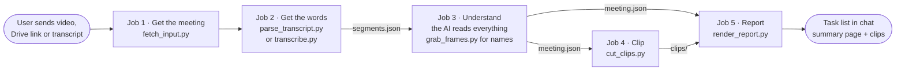

# How it works: the five jobs

The skill is a pipeline of five jobs. Scripts do the mechanical work. The AI does the
understanding. The user only does the first arrow.

```
 USER                         THE SKILL
 ────                         ─────────────────────────────────────────────────────────────────
 sends a video,          ┌──────────────────┐   ┌──────────────────────┐   ┌───────────────────┐
 a Drive link,     ────► │ JOB 1            │──►│ JOB 2                │──►│ JOB 3             │
 or a transcript         │ GET THE MEETING  │   │ GET THE WORDS        │   │ UNDERSTAND        │
 + "who is who"          │                  │   │                      │   │ (the AI)          │
                         │ download from    │   │ transcript? parse it │   │ tasks: who, whom, │
                         │ Drive, or take   │   │ video only? listen   │   │   what, when      │
                         │ the file as is   │   │ to it (speech-to-    │   │ questions+answers │
                         │                  │   │ text, on this        │   │ topics, who said  │
                         │ fetch_input.py   │   │ computer)            │   │   what            │
                         └──────────────────┘   │ parse_transcript.py  │   │ decisions         │
                                                │ transcribe.py        │   │ unclear points    │
                                                └──────────────────────┘   │ looks at video    │
                                                   segments.json           │ frames for names  │
                                                                           │ and shared screen │
                                                                           │ grab_frames.py    │
                                                                           └─────────┬─────────┘
                                                                                meeting.json
                                                         ┌───────────────────────────┴──┐
                                                         ▼                              ▼
 gets the answer         ┌──────────────────┐   ┌──────────────────────┐
 in the chat       ◄──── │ JOB 5            │◄──│ JOB 4                │
 + summary page          │ REPORT           │   │ CLIP                 │
 + clips                 │ summary page with│   │ one clip per task,   │
                         │ clip players, and│   │ question, decision   │
                         │ the task list in │   │ + subtitles          │
                         │ the chat         │   │ cut_clips.py (ffmpeg)│
                         │ render_report.py │   └──────────────────────┘
                         └──────────────────┘
```

The same flow as a chart (renders on GitHub):



| Job | Done by | Takes in | Produces | Why it exists |
|---|---|---|---|---|
| 1 Get the meeting | script | a link or a file | the recording / transcript in a folder | the user should not have to download or export anything |
| 2 Get the words | script | transcript, or the video's audio | `segments.json`: who said what, when | one format for everything that follows |
| 3 Understand | the AI | `segments.json` + video frames | `meeting.json`: tasks, Q&A, topics, decisions | this is the thinking a tired staff member cannot do from memory |
| 4 Clip | script | `meeting.json` + recording | `clips/` | hear the instruction in the boss's own words |
| 5 Report | script, checked by the AI | `meeting.json` | `MEETING_SUMMARY.html`, answer in chat | one page to act on |

## Two input paths

| You send | Names of speakers | Clip timing | Speed |
|---|---|---|---|
| Recording **and** transcript Doc | from the Doc, reliable | good | fast |
| Transcript Doc only | from the Doc | no clips (no video) | fastest |
| Recording only | worked out from the conversation and the on-screen name labels; flagged when unsure | accurate to the sentence | adds listening time |

## What runs where

- On the user's computer: downloading, speech-to-text, frame grabs, clip cutting, the report.
- In the AI model: reading the text of the meeting and a handful of still frames.
